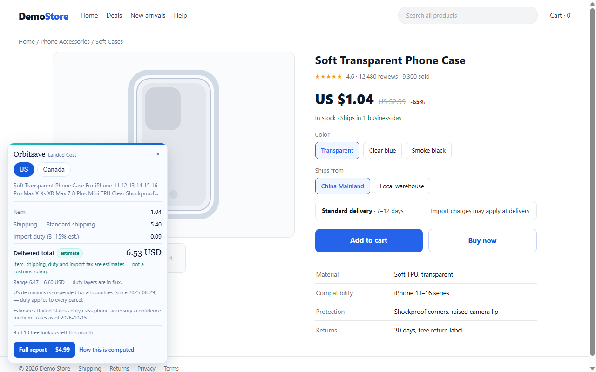
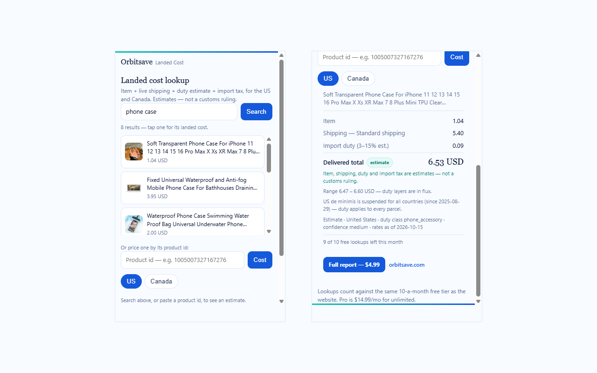

  

<h1 align="center">Orbitsave</h1>

<strong>Know the all-in delivered cost of anything from China.</strong> 
Item + live shipping + US/Canada duty and tax — and the candidate suppliers behind it.

  <a href="https://orbitsave.com"><strong>orbitsave.com</strong></a>

---

## What Orbitsave is

Orbitsave answers two money questions for anyone who buys goods from China and sells or ships
them into the United States or Canada:

1. **What does it really cost delivered?** The item price, a live shipping quote, and estimated
   US or Canadian import duty and tax — combined into one all-in delivered cost, per product and
   per quantity (1, 10, 100 or 1,000 units).
2. **Who makes it?** The same lookup surfaces the candidate suppliers behind a product, with the
   exact variant/SKU and a ready-to-use order spec.

It is honest by design. Every quote shows the rate date, the exchange rate used and a confidence
level: **estimates with an accuracy promise — never a customs ruling.** If the duty you are
actually charged comes in more than 25% over our estimate, we credit what you paid for it. And
when a live freight quote is unavailable, Orbitsave shows no total at all instead of a number
that would be wrong.

## Live

- **Product & free tool:** https://orbitsave.com — 10 free lookups a month, no card
- **Guides:** https://orbitsave.com/guides/ — de minimis, landed cost, Canada duty, finding the factory
- **API & MCP documentation:** https://orbitsave.com/docs/ — a REST API and an MCP server for AI agents
- **Sample report:** https://orbitsave.com/sample-report
- **Status:** https://orbitsave.com/status/

## Pricing

| Tier | Price | What it is |
|---|---|---|
| Free | $0 | 10 landed-cost lookups a month, no account |
| Supplier Source Report | $4.99 once | One product: candidate suppliers + landed cost |
| Pro | $14.99/mo | Unlimited lookups (US + Canada) and the AI analyst |
| Studio API | from $4.99/mo | REST + MCP access for software and agents |

## The browser extension

A companion extension — **Orbitsave — Landed Cost** — brings the same landed-cost card directly
onto the product page you are already viewing: item, shipping, duty estimate and tax, in one look.

## Tech, at a glance

- A server-side engine that computes every figure in code — freight, duty, tax and totals are
  never guessed
- A public **REST API** and an **MCP server**, so software and AI agents can call the same engine
  the website uses
- A fast static front end and documentation
- A **Manifest V3 browser extension** — plain JavaScript, zero build step
- AI models assist with product classification and analysis; they never invent a price or a rate

## What this repository is

This is the **public, brand-facing repository for Orbitsave.** It presents what Orbitsave is.
It is not a build guide, and the application, engine and operating systems are not published here.

## Ownership

Orbitsave is a brand of **Axiopistis Holdings LC**, a privately held company in Atlanta, Georgia.

Contact: hello@orbitsave.com

---

Estimates with an accuracy promise — not a customs ruling. 
© Axiopistis Holdings LC. All rights reserved.

